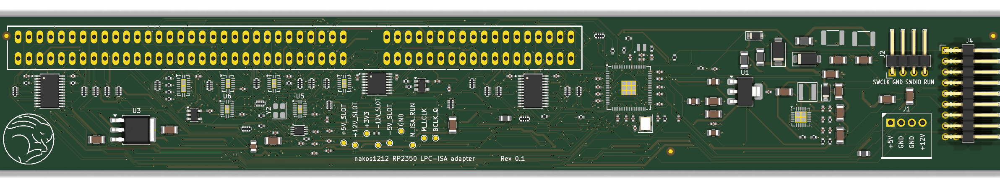
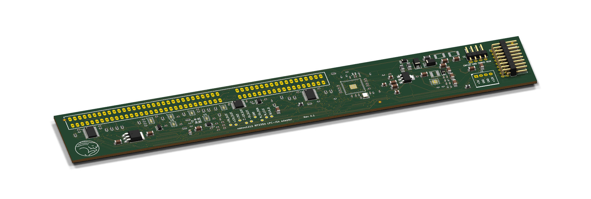
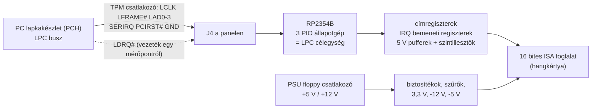

# isa-lpc-bridge: valódi 16 bites ISA foglalat modern alaplapon, a TPM csatlakozón keresztül

[English version: README.md](README.md)

Egy hosszú, keskeny átalakító panel egy **16 bites ISA foglalattal**, amely a modern PC **TPM csatlakozójára (LPC busz)** csatlakozik.
Retro **hangkártyákhoz DOS-ban és DOS-alapú rendszerekben** készült (Sound Blaster, Gravis UltraSound, AWE32, Orpheus II, ...).
Mint a [dISAppointment](https://github.com/rasteri/dISAppointment), de a Fintek F85226 híd-IC helyett egy mikrokontroller
(RP2354B, C nyelvű firmware) dolgozik, így az egész nyitott és módosítható.

> **Állapot.** A `PASS_HG25` revíziót megterveztük, adatlapok alapján átnéztük és 2026 novemberében gyártatásra küldtük;
> a hardver üzembe helyezése folyamatban van. Az alábbi kártyakompatibilitás várt viselkedés, adatlapokból és Linux-meghajtók
> forrásából levezetve. Visszajelzést és javítást szívesen fogadunk.





*3D renderek KiCad-ből. Az ISA foglalatnak és a tápcsatlakozónak nincs 3D modellje, ezért lábfoltként/körvonalként látszanak.*

## Dióhéjban

| | |
|---|---|
| Panel | 240,1 x 36,1 mm, 4 réteg, 1,6 mm, egyoldalas beültetés |
| Foglalat | egy 98 pólusú, 16 bites ISA élcsatlakozó (ED98KBGFBK, LCSC C5173323) |
| Host felé | 2x9-es, derékszögű csatlakozó, 1:1-ben a gyakori 17/18 pólusú „TPM csatlakozóra" huzalozva: LCLK, LFRAME#, LAD0-3, SERIRQ, PCIRST#, GND (**3,3 V logika**) |
| LDRQ# | egy külön vezeték, **nincs rajta a TPM csatlakozón** (lásd [LDRQ# megszerzése](#az-ldrq-megszerzése-dma-hez-kell)) |
| Táp | a tápegységről 4 pólusú floppy (Berg) tápcsatlakozón: +5 V és +12 V. A -12 V, -5 V és 3,3 V a panelen készül |
| MCU | RP2354B (QFN-80, 2 MB belső flash), alapból 400 MHz, SWD-n programozható (a panelen nincs USB) |
| Tudja | ISA I/O ciklusok, 8 és 16 bites DMA (0-3 és 5-7 csatorna), IRQ 3-7, 9-12, 14, 15 és IOCHCK# SERIRQ-n át, ISA reset |
| Nem tudja | ISA memóriaciklusok, busmaster, refresh, MEMCS16#/OWS# érzékelés |
| Host eszköz | `ISALPC.EXE` (DOS) / `isalpc` (Linux): beállítja a lapkakészlet LPC dekódoló ablakait és a hidat, gyakori kártyákhoz készletekkel |



## Tartalom
1. [Kinek való és mi kell hozzá](#kinek-való-és-mi-kell-hozzá)
2. [Kompatibilitás](#kompatibilitás)
3. [Beépítés házba](#beépítés-házba)
4. [Bekötés](#bekötés)
5. [Az LDRQ# megszerzése](#az-ldrq-megszerzése-dma-hez-kell)
6. [Első bekapcsolás ellenőrzőlista](#első-bekapcsolás-ellenőrzőlista)
7. [Firmware](#firmware)
8. [Host beállítása: ISALPC](#host-beállítása-isalpc)
9. [Alaplapi BIOS megjegyzések](#alaplapi-bios-megjegyzések)
10. [Építés](#építés)
11. [Tároló felépítése](#tároló-felépítése)
12. [Furcsaságok és korlátok](#furcsaságok-és-korlátok)
13. [Köszönet és licencek](#köszönet-és-licencek)

## Kinek való és mi kell hozzá
- **LPC buszt kivezető TPM csatlakozós** alaplap, és olyan lapkakészlet, amelynek LPC hídja I/O tartományokat tud továbbítani (Intel PCH
  általános dekódoló ablakok; AMD-n az [lpcexp](https://github.com/lss4/lpcexp) működik, de a mi eszközünk ezt nem fedi le).
- Forrasztási jártasság: a panelt a gyártó beülteti, de DMA-hoz **az LDRQ#-t neked kell bekötnöd** az alaplapra (vékony vezeték
  egy mérőpontra vagy ellenállás-padra).
- SWD programozó (CMSIS-DAP: Raspberry Pi Debug Probe, picoprobe-ot futtató Pico, ...) és OpenOCD a firmware betöltéséhez.
- Tápegység szabad floppy tápcsatlakozóval (a 4 vezetékes: piros +5 V, fekete, fekete, sárga +12 V).
- DOS indítókörnyezet a hoston (MS-DOS/FreeDOS/Win9x, legacy/CSM módú indítással).
- Az üzembe helyezéshez erősen ajánlott oszcilloszkóp vagy logikai analizátor. Szilíciumon még semmit nem mértünk.

## Kompatibilitás

### Alaplapok / lapkakészletek
| Host | I/O + IRQ | DMA | Megjegyzés |
|---|---|---|---|
| **ASRock Fatal1ty X99M Killer** (Intel X99 / C610) | tervezési cél | tervezési cél | BIOS-elemzés: [docs/bios-x99m-killer-p4.01.md](docs/bios-x99m-killer-p4.01.md); 17 pólusú TPMS1 csatlakozó |
| Más Intel lapkakészletek **a 100-as sorozat előtt** (6/7/8/9 sorozat, X79/X99/C600) | várhatóan működik | várhatóan működik, LDRQ# vezeték kell | ezeken van LPC DMA. A csatlakozó-kiosztás alaplaponként eltér: mérd ki multiméterrel |
| Intel **100-as sorozat és újabb** (Skylake-tól) | várhatóan működik (a GEN dekódoló ablakok megvannak) | **nincs**: az Intel a 100-as sorozattól elhagyta az LDRQ#-t | FM szintézis, MIDI és PIO hang működik; a DOS-játékok digitalizált hangjához DMA kell, az nem lesz. Lásd az [lpcexp readme](https://github.com/lss4/lpcexp)-t |
| AMD (AM4 és hasonlók) | az lpcexp-et használd (AMD kód), nem az `isalpc`-t | AM4: nem ismerjük; **AM5/SP5: nincs LDRQ#** | nem része |

A „DMA a 100-as sorozatig" röviden: a lapkakészletnek kell egy LDRQ# láb, és az Intel ezt a 100-as sorozattól elhagyta. A pontos
határra vonatkozó információnk az lpcexp projektből származik, adatlapokkal nem ellenőriztük. Csak az X99 a tervezési célunk.

### Hangkártyák (várható, adatlapokból és Linux-meghajtók forrásából)
A zárójelben lévő `ISALPC` készletek beállítják a lapkakészletet és a hidat a kártyához.

| Kártya | Várakozás | Megjegyzés |
|---|---|---|
| Sound Blaster 1.x/2.0/Pro, **Sound Blaster 16** (`sb`, `sb16`) | működik | csak bájtos I/O. 8 bites DMA 1, 16 bites DMA 5. IRQ 5/7. MPU-401 a 330-on |
| AdLib, OPL2/OPL3 (`adlib`) | működik | 388-38B portok, IRQ és DMA nélkül |
| **Gravis UltraSound** klasszikus (`gus`, `gusmax`) | működik | alap 240; a base+0x104 szóelérés kezelve |
| **GUS PnP / AMD InterWave** (`guspnp`) | működik | az ISA PnP portokat (279, A79, olvasási port) továbbítani kell: az `@pnp` benne van |
| **Orpheus II** (`orpheus2`) | várható | CS4237B + InterWave + OPL3 + PCMIDI; mind a négy LPC ablak kell. A 534-es WSS ütközik a lapkakészlet GPIO blokkjával egyes lapokon (X99M): az `ISALPC` elmozgatja a blokkot, **csak DOS-ban** |
| **AWE32/AWE64** (`awe32`) | várható | az EMU8000 16 bites I/O-t használ (620/A20/E20 portok): támogatott. Öt 256 portos blokk kell, ez több a lapkakészlet ablakainál, hacsak fel nem szabadítod a Super I/O és COM dekódolókat |
| Yamaha OPL3-SAx, ESS AudioDrive, Crystal CS423x, WSS (`opl3sa`, `ess`, `cs423x`, `wss`) | várható | az 530-as WSS alap az X99M-szerű lapokon a GPIO blokkba esik (lásd fent) |
| MPU-401 kártyák, Roland SCC-1/LAPC-I (`mpu401`) | várható | a panel -12 V-ot és -5 V-ot is előállít |
| Pro Audio Spectrum 16 | **lehetetlen** | a regiszterei 19 port-blokkon szóródnak, a lapkakészletnek négy dekódoló ablaka van |
| Turtle Beach MultiSound / Pinnacle / Fiji, bármely kártya on-board memóriaablakkal | **nem támogatott** | ISA *memória*ciklusok kellenek. Az UEFI-s gépek amúgy is elfoglalják azt a memóriaterületet |
| ADI/Echo PSS | lehetséges | a 16 bites olvasáshoz `word_rd` bejegyzés kell (kikommentezett sor a `fw/src/main.c`-ben) |
| Floppy, COM, LPT, IDE, NE2000, SCSI ISA kártyák (`fdc`, `com1`, `lpt1`, `ide1`, `ne2000`, ...) | a készletek léteznek, de nem ez a projekt célja | előbb kapcsold ki a lapi portokat a BIOS-ban, különben mindkettő válaszol |

Nem cél: ISA VGA kártyák, busmaster kártyák, memóriát igénylő kártyák.

A kártyalista alapja: a Linux ISA hangmeghajtóinak áttekintése 16 bites I/O-ra ([docs/card-io-survey.md](docs/card-io-survey.md)),
az AMD InterWave és a Cirrus CS4237B adatlap, valamint a lapkakészlet TPM/LPC dokumentumai.

## Beépítés házba
- A panel **240 mm hosszú és 36 mm széles**. Olyan házhoz készült, ahol **két szabad PCI/bővítőhely** van egymás mellett
  (microATX vagy ATX alaplap üres alsó foglalatokkal); mérd meg a házadat, mielőtt rendelsz.
- **Nincsenek rögzítőfuratok.** **Vastag kétoldalas habszalaggal vagy műanyag távtartókkal/lábakkal rögzítsd a panel alá.**
  Támasz nélkül a panel behajlik a kártya behelyezésekor: a foglalat adatlapja érintkezőpáronként legfeljebb 0,4 kgf-et ad meg, ez egy teljes, 98 pólusú kártyánál nagyjából 20 kgf-ig terjedhet, ezért szilárd,
  egyenletes alapra tedd, és a panelt lefogva told be a kártyát.
- Az ISA foglalat egyenes élcsatlakozó: a **kártya a panelből felfelé áll** (az alsó éle kb. 8 mm-re van a NYÁK felett).
  Ellenőrizd a szomszédos PCIe kártyák, a ház bordái és a kártya saját fedele közti helyet. A kártya fedele
  **lehet, hogy nem esik egybe a ház nyílásával** (háza válogatja): valószínűleg nem csavarozod le, vagy fedél nélküli rögzítést használsz.
- A kábelek a hosszú él jobb végéből indulnak: a táp (J1), az SWD csatlakozó (J2) és a 2x9-es TPM-szerű csatlakozó (J4)
  derékszögű alkatrészek. A magas alkatrészek a három csatlakozó és a tápcsatlakozó.
- Az LPC vezetékeket tartsd **rövidre** (10 cm vagy kevesebb), és használd a J4 földlábait.
- A tápot a **PSU floppy csatlakozójáról** vedd. A panel soha nem vesz fel áramot a TPM csatlakozóról.

## Bekötés

### J1 tápcsatlakozó (4 pólusú floppy/Berg, derékszögű)
| Láb | Jel |
|---|---|
| 1 | +5 V (piros vezeték) |
| 2, 3 | GND |
| 4 | +12 V (sárga vezeték) |

Biztosítékok: +5 V-on 2,6 A tartó, +12 V-on 1,5 A tartó (visszaálló). Mindkét sínen túlfeszültség-védő dióda.
**Az első bekapcsolás előtt multiméterrel ellenőrizd a polaritást**: a csatlakozó kódolt és a gyártói rajzzal egyeztettük,
de valódi dugóval, valódi panelen még nem.
A tápcsatlakozót csak kikapcsolt tápegységnél dugd be és húzd ki.

### J4 host csatlakozó (2x9, 2,54 mm, derékszögű)
1:1-ben az ASRock-féle TPM csatlakozóra huzalozva. A lábszámozás a szabványos 20-1 pólusú TPM kiosztás szerinti (a páratlan lábak
az egyik, a párosak a másik sorban; **a 13-as láb a kódoló pozíció, az alaplapi csatlakozóról hiányzik**). Mindig a *saját* alaplapodon ellenőrizd.

| J4 láb | Jel | Láb | Jel |
|---|---|---|---|
| 1 | LCLK (PCICLK) | 2 | GND |
| 3 | LFRAME# | 4 | nincs bekötve |
| 5 | PCIRST# | 6 | nincs bekötve |
| 7 | LAD3 | 8 | LAD2 |
| 9 | nincs bekötve (a hoston +3V) | 10 | LAD1 |
| 11 | LAD0 | 12 | GND |
| **13** | **LDRQ# (100 ohm sorosan, 4,7 k felhúzó 3,3 V-ra a panelen)** | 14 | nincs bekötve |
| 15 | nincs bekötve (a hoston +3VSB) | 16 | SERIRQ |
| 17 | GND | 18 | GND |

A host +3V, +3VSB, SMBus és S_PWRDWN# lábai **szándékosan nincsenek** bekötve.

### J2 SWD csatlakozó (1x4)
`SWCLK, GND, SWDIO, RUN` (az 1-es láb a SWCLK végén, a szitanyomaton jelölve).

### Mérőpontok
`TP1` +5V_SLOT, `TP2` +12V_SLOT, `TP3` +3V3, `TP4` -12V, `TP5` -5V, `TP6` GND, `TP7` ISA_RUN, `TP8` LCLK, `TP9` BCLK (osztott oszcillátor).

## Az LDRQ# megszerzése (DMA-hez kell)
Az LPC buszon a DMA-t egy külön jel, az **LDRQ#** kéri. A TPM csatlakozón ez nincs rajta, az alaplapról magadnak kell
elvenned. Nélküle minden más működik (I/O ciklusok, IRQ-k, FM/OPL zene), de ami DMA-t igényel (digitalizált hang DOS játékokban,
SB/GUS minta lejátszás), az nem fog.

1. **Keresd meg a jelet.** A lapkakészletnek van LDRQ0# lába (néhánynak LDRQ1# is). A legtöbb lapon ez a Super I/O chiphez
   (COM/LPT/PS-2) fut, és útközben gyakran van rajta mérőpad, soros ellenállás, 0 ohmos áthidalás vagy átvezetés. Nézd meg
   az alaplap kapcsolási rajzát vagy boardview-ját, ha van, vagy mérd ki a Super I/O LDRQ# lábát. A jel **3,3 V-on áll
   magasan** üresjáratban, és DMA kéréskor húzza le. Soha nem szabad 5 V-ra kötni.
2. **Forrassz egy vékony vezetéket** (a 30 AWG-s wire-wrap vezeték jó) arra a pontra.
3. **A másik végét kétféleképp kösd a panelhez:**
   - **Közvetlenül:** Dupont jumper vezetékkel vagy magával a vezetékkel a **J4 13-as lábra** (az a láb, amelyik az alaplapi TPM
     csatlakozóról hiányzik, ezért a TPM-szerű kábel nem tudja vinni).
   - **A TPM csatlakozó kábelén át:** ha készítesz vagy módosítasz egy szalagkábelt az alaplapi TPM csatlakozó és a J4 között, a vezetéket
     a 13-as láb helyére add a J4-es végen. Tartsd rövidre a csonkot.
4. Tartsd rövidre a vezetéket, vezesd egy földvezeték mellett (J4 12/17/18 láb) és az órajeltől távol.
5. **Kapcsold ki a Super I/O saját LPC DMA-használóit** (floppy, ECP módú párhuzamos port) a BIOS-ban, hogy a Super I/O ne hajtsa
   ugyanazt az LDRQ# vezetéket egyszerre.
6. Egyes lapkakészleteken az LDRQ1# GPIO-val van multiplexelve. Ha ezt a lábat választottad, az `ISALPC LDRQ1` átkapcsolja a
   padot LDRQ1#-re. A szerző ASRock X99M Killerén (BIOS P4.01) az LDRQ1# pad már LDRQ funkcióra van állítva (a BIOS-kép statikus
   elemzéséből).

> **A szerző X99M Killerén a pontos mérőpont még nincs dokumentálva.** A vezetéket a cikk írásakor még nem forrasztottuk be.
> Ha megvan, ide kerül a pont, egy fotó és a DMA teszt eredménye. Addig az 1-6. lépéseket multiméterrel követendő
> eljárásnak tekintsd, nem bevált receptnek.

## Első bekapcsolás ellenőrzőlista
1. Mielőtt bármit behelyeznél, ellenőrizd a **J1 polaritását** multiméterrel: piros vezeték a TP1-hez (+5 V), sárga a TP2-höz (+12 V).
2. **Soha ne járasd a PC-t úgy, hogy a J4 be van dugva és a J1 ki van húzva.** Az MCU LPC lábai nem 5 V toleránsak, és a host
   3,3 V-ja visszatáplálná a táp nélküli chipet.
3. A tápot kikapcsolt PSU-nál dugd be. Kapcsold be *ISA kártya nélkül* és *J4 nélkül*. Mérd a sínek feszültségét a mérőpontokon:
   +5 V, +12 V, **+3,3 V**, **-12 V (kb. -12,1 V)** és **-5 V**.
4. Töltsd be a firmware-t SWD-n (lásd lent), és oszcilloszkóppal nézd a `RESETDRV`/`ISA_RUN` viselkedést.
5. Mérd az **LCLK**-t az MCU lábán, mielőtt a J4-et rádugod; az LPC lábakat közvetlenül a PIO állapotgépek hajtják.
6. A J4-et kikapcsolt PC-nél dugd be, aztán kapcsold be mindkettőt. Futtasd az `ISALPC`-t és olvasd le az állapotot.
7. Csak ezután tegyél be kártyát. Nézd a DRQ és IOCHRDY vonalakat az MCU-nál: ha valódi kártyával kb. 5,4 V fölé mennek, tegyél
   soros ellenállást vagy szorítódiódát.
8. A kártya behelyezése előtt támaszd meg a panelt (lásd [Beépítés](#beépítés-házba)).

## Firmware
A forrás a [`fw/`](fw/) mappában (pico-sdk 2.1 vagy újabb, `arm-none-eabi-gcc`, cmake, ninja). A 11-es build kész képei:
[`fw/prebuilt/`](fw/prebuilt/) (`isa_lpc_flash_build11.elf`, `isa_lpc_ram_build11.elf`).

- **Felépítés:** három PIO blokk valósítja meg az LPC célegységet (előtét, válaszscript-lejátszó, LDRQ#/SERIRQ motorok);
  az 1-es mag a 3 órajeles SYNC határidőn belül lefoglalja az LPC ciklusokat; a 0-s mag hajtja az ISA buszt (cím a léptető
  regisztereken át, stróbok, IOCHRDY várakozás, DMA). Részletek: [fw/README.md](fw/README.md) és [docs/firmware-review.md](docs/firmware-review.md).
- **Flash:** `fw/tools/flash.sh` (OpenOCD + CMSIS-DAP programozó a J2-n). A panelen **nincs USB/BOOTSEL**.
- **Fejlesztéshez nem kell flash:** a `fw/tools/ram.sh` SWD-n betölti a RAM képet; a hangolható értékek a `0x2007C000`-nál lévő
  RAM blokkban vannak, OpenOCD-vel élőben állíthatók (`fw/tools/isa.tcl`).
- **Konfigurációs port:** a híd a **4E/4F** I/O portokon válaszol (mint a Fintek chip); az `ISALPC` ezt használja. Az 'I','S','A'
  index oldja fel. Egy jelzővel kikapcsolható.
- **Hardver nélküli tesztek:** `python3 fw/sim/test_lpc.py`, `python3 fw/sim/test_aux.py` (a PIO programok ciklus-szimulátora),
  `cc -Ifw/src -o /tmp/t fw/test/io16_test.c && /tmp/t`, ugyanígy a `cfgport_test.c`.
- Szilíciumon nem ellenőrzött: a PIO időzítés a valódi LCLK-hoz képest, a 400 MHz-es órajel és az 1,30 V-os mag, a flash időzítés, a SERIRQ csendes mód.

## Host beállítása: ISALPC
A lapkakészlet csak azokat az I/O tartományokat továbbítja, amelyeket megmondtak neki, a híd pedig csak az általad használt kártya
portjait veszi át. Mindkettőt az `ISALPC` (DOS, `host/ISALPC.EXE`) vagy az `isalpc` (Linux, rootként) végzi. **Minden indítás után
futtasd** (a lapkakészlet ablakait a BIOS nullázza, a híd beállításai RAM-ban élnek): tedd az `AUTOEXEC.BAT`-ba a hangmeghajtók elé.

```
ISALPC                      dekódoló ablakok, SERIRQ, PCI IRQ-k és a híd állapota (nem ír semmit)
ISALPC SB16                 Sound Blaster 16 a 220-on, MPU 330, OPL 388, játékport
ISALPC SB16 FORCE DRY       kiírja, mit tenne, nem változtat semmit
ISALPC GUS=240              Gravis UltraSound a 240 alapcímen
ISALPC ORPHEUS2 FORCE       Orpheus II: szükség szerint cseréli a BIOS ablakait
ISALPC AWE32 FORCE NOPIRQ   AWE32, a PCI megszakítás-irányítást is kikapcsolja a híd által kiszolgált IRQ-kra
ISALPC LIST                 az összes készlet
```
Kapcsolók: a `FORCE` a BIOS által beállított dekódoló ablakokat cseréli (a lehető legkevesebbet, a legmagasabbal kezdve, és kiírja,
melyeket), a `DRY` nem változtat semmit, a `DMA` nullázza a DMA vezérlőket (DOS-ban alapértelmezett), az `LDRQ1` a GPIO padot
LDRQ1#-re kapcsolja, a `NOPIRQ` leállítja a PCI megszakítások irányítását a híd által kiszolgált IRQ-kra, a `KEEPSIRQ`
békén hagyja a Serial IRQ módot (alapból folyamatos módra állít), az `IRQ=5,7` pontosan megadja a kiszolgált IRQ-kat, a `GPIO=680`
kiválasztja, hová költözzön a lapkakészlet GPIO blokkja, ha egy kártya a benne lévő portokat igényli (**csak DOS**: az ACPI-s operációs
rendszerek a régi címet várják).

Korlátok, amelyekbe beleütközöl: négy, egyenként legfeljebb 256 portos dekódoló ablak, ablakonként egy 256 portos blokk; a 279-es port
(ISA PnP címport) az LPT dekódolón át csak olvasható, ezért a PnP kártyáknak ablak kell. Az eszköz megtagadja a lapkakészlet saját
regiszterblokkjaiba eső portokat. Az `isalpc.c` a sapphisából és az lpcexp-ből származik (CC BY-SA 4.0); a DOS-os részhez Open Watcom kell az építéshez.

Linux: `cc -O2 -o isalpc host/isalpc.c`, rootként futtasd. DOS: `make -C host ISALPC.EXE` Open Watcommal, vagy használd a kész EXE-t.

## Alaplapi BIOS megjegyzések
- **Kapcsold ki a lapi COM, LPT, floppy és minden más, nem kellő LPC-s eszközt.** Ugyanazokért a portokért és DMA csatornákért versengenek,
  és egyesek olyan LPC ablakokat használnak, amelyek a kártyának kellenek. Hagyd bekapcsolva a CSM/legacy indítást és a legacy USB-t (DOS billentyűzethez).
- Nincs beállítás, amely egy IRQ-t ISA kártyának foglalna le: egy PCI eszköz ráeshet a kártya IRQ-jára. Az `ISALPC` kilistázza
  a PCI által használt IRQ-kat, a `NOPIRQ` pedig elveheti őket a PCI-tól.
- A Serial IRQ-t állítsd **folyamatos** módra. Az `ISALPC` megteszi helyetted.
- **ASRock X99M Killer 3.1, BIOS P4.01**: elemzés a [docs/bios-x99m-killer-p4.01.md](docs/bios-x99m-killer-p4.01.md) fájlban: a négy általános
  dekódoló ablakból három foglalt, a lapkakészlet GPIO blokkja az 500-57F tartományban van (ütközik az 530/534-es WSS/Orpheusszal), a serial IRQ
  csendes módban indul. Egy opcionális javító ([tools/bios/patch_x99m.py](tools/bios/patch_x99m.py)) bekapcsolástól kezdve felszabadítja a
  fölösleges ablakokat (7 bájt). Ellenőrzi az eredeti kép sha256-ját, és csak azt módosítja, amit felismer. **Maga a BIOS kép
  nincs ebben a tárolóban** (az ASRock firmware-e). Módosított firmware-t csak akkor flashelj, ha van SPI programozód és
  mentésed. Az `ISALPC` futásidőben ugyanezt megteszi, ezért a javítás opcionális.

## Építés
| Mit | Hogyan |
|---|---|
| Firmware | `export PICO_SDK_PATH=...; fw/tools/build.sh` (flash kép) vagy `fw/tools/build.sh ram` |
| DOS eszköz | Open Watcom 2: `make -C host ISALPC.EXE` (16 bites kis modell) |
| Linux eszköz | `cc -O2 -o isalpc host/isalpc.c` |
| Eszköz önteszt | `make -C host test` (álchipset + a firmware konfigurációs port kódja) |
| Hálólista | `python3 sch/build.py` (SKiDL, KiCad 10 könyvtárak), `python3 tools/netcheck.py` |
| Panel | nyisd meg a `pcb/PASS_HG25.kicad_pcb`-t **KiCad 10**-zel; egyedi lábnyomok: `lib/isa_bridge.pretty` (add hozzá a lábnyomtáradhoz) |
| Gyártási fájlok | `fab/PASS_HG25_gerbers.zip`, `fab/bom.csv`, `fab/cpl.csv` (JLCPCB formátum, LCSC számok a BOM-ban) |
| Adatlapok | `docs/datasheets/` (tartalomjegyzék a README-jében) |
| Független távolság-ellenőrzés | `tools/review/via_copper_audit.py` (KiCad Python) |

## Tároló felépítése
```
pcb/       KiCad 10 panel (PASS_HG25), projekt és tervezési szabályok (JLCPCB többrétegű minimumok)
fab/       gerberek, BOM, beültetési fájl, LCSC alkatrészlista
sch/       build.py: a teljes hálólista SKiDL kódként (nincs .kicad_sch fájl)
lib/       egyedi lábnyomok és szimbólumok, adatlap-lábtáblák
fw/        RP2354B firmware, PIO programok, szimulátor, tesztek, kész képek
host/      ISALPC (DOS és Linux) és önteszt
tools/     hálólista-ellenőrző, szimbólumgenerátor, BIOS-elemző szkriptek, távolság-ellenőrzés
docs/      lábkiosztás, BIOS-elemzés, kártya I/O áttekintés, átnézések, rendelési jegyzetek
images/    renderek
```

## Furcsaságok és korlátok
- A panel beállításai RAM-ban vannak: áramtalanítás után a híd elfelejti a portszűrőt. Futtasd újra az `ISALPC`-t.
- Az ISA buszt egy MCU hajtja léptető regisztereken át: **lassabb, mint egy valódi ISA foglalat** (még nem mértük), és az I/O írások
  „postázottak". A 16 bites olvasás-párosítás csak a `cfg.word_rd`-ben lévő portokon aktív (EMU8000, InterWave).
- Az ISA oldalon 5 V-os logika pufferen át; az MCU oldal 3,3 V. Az `IOCS16#`-t minden címváltás után mérjük.
- Nincs USB, nincs BOOTSEL gomb: egy hibás flasheléshez SWD programozó kell. A RAM kép elkerüli a flashelést.
- A panel a tápját csak a PSU floppy dugójáról kapja; a dugót használd, ne az alaplapi csatlakozót.
- A kézzel bekötött LDRQ# miatt ez **hobbi/kísérleti panel**, nem plug-and-play termék.
- Túlhajtás: alapból 400 MHz 1,30 V-on (ablak: 340-500 MHz). A mag szabályzója és a 3,3 V-os LDO melegszik.
- Az ISA PnP kártyákhoz dekódoló ablak kell a PnP portokra; a négy ablakos korláttal együtt ez szűkíti, mi fér el
  (AWE32 + PnP nem).

## Köszönet és licencek
- Az ötlet és a DOS-os eszköz alapja: **rasteri [dISAppointment](https://github.com/rasteri/dISAppointment)** (CC BY-SA 4.0): ISA foglalat
  lábnyom, felhúzó hálózat, `sapphisa`; **[lpcexp](https://github.com/lss4/lpcexp)** (CC BY-SA 4.0): lapkakészlet
  regiszterprogramozás, DMA nullázás. Az MCU tápáramköre a Raspberry Pi RP2350 minimal terve nyomán készült (MIT).
- **Hardver, host eszköz, könyvtárak, hálólista szkript: CC BY-SA 4.0.** **Firmware, BIOS-elemző szkriptek, ellenőrző szkriptek: MIT.**
  Lásd [LICENSE.md](LICENSE.md) és [LICENSES/](LICENSES/).
- Garancia nincs. Egy saját kezűleg összeszerelt panelre tápegységet dugni és alaplapra forrasztani mindkettőt tönkreteheti.
  Mindez a saját felelősségedre történik.
