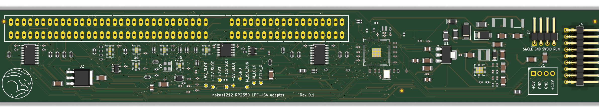
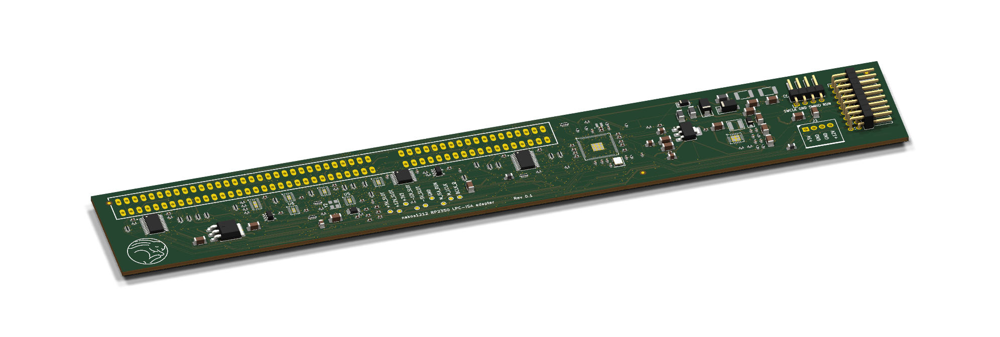
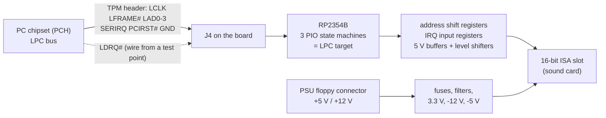

# isa-lpc-bridge: a real 16-bit ISA slot on a modern motherboard, through the TPM header

A riser board with one **16-bit ISA slot** that connects to a modern PC through its **TPM header (LPC bus)**.
It is meant for **legacy ISA cards under DOS and DOS-based systems**: sound cards (Sound Blaster, Gravis UltraSound, Orpheus II, ...), I/O and
serial cards, and other I/O-mapped cards with IRQ and DMA.
Like [dISAppointment](https://github.com/rasteri/dISAppointment), but with a microcontroller (RP2354B, firmware in C) in
place of the Fintek F85226 bridge chip, so the whole thing is open and tweakable, and does not rely on a custom, hard to get ASIC.

> **Status.** Revision `PASS_HG25` works. Tested by the author with a **Sound Blaster 16, Gravis UltraSound, GUS PnP,
> Orpheus II and a generic OPL3-SAx card** (all working without problems, **including DMA** through the LDRQ# wire) and an ISA **floppy/COM port card**. Cards in the table below that are not marked
> *tested* are expected to work from datasheets and Linux driver sources. Reports and fixes are welcome.





*3D renders from KiCad. The ISA socket and the power connector have no 3D model in the render and show as pads/outline.*

## Base specs

| | |
|---|---|
| Board | 240.1 x 36.1 mm, 4 layers, 1.6 mm, single sided assembly |
| Slot | one 98-pin 16-bit ISA edge socket (ED98KBGFBK, LCSC C5173323) |
| Host link | 2x9 right-angle header wired 1:1 to the common 17/18-pin "TPM header": LCLK, LFRAME#, LAD0-3, SERIRQ, PCIRST#, GND (**3.3 V logic**) |
| LDRQ# | one extra wire, **not on the TPM header** (see [Getting LDRQ#](#getting-ldrq-needed-for-dma)) |
| Power | from the PSU through a 4-pin floppy (Berg) power connector: +5 V and +12 V. -12 V, -5 V and 3.3 V are made on the board |
| MCU | RP2354B (QFN-80, 2 MB internal flash), 400 MHz default, programmed over SWD (no USB on the board) |
| Provides | ISA I/O cycles, 8-bit and 16-bit DMA (channels 0-3 and 5-7), IRQ 3-7, 9-12, 14, 15 and IOCHCK# through SERIRQ, ISA reset |
| Does not provide | ISA memory cycles, bus mastering, refresh, MEMCS16#/OWS# sensing |
| Host tool | `ISALPC.EXE` (DOS) / `isalpc` (Linux): programs the chipset's LPC decode windows and the bridge, with presets for common cards |



## Contents
1. [Who this is for and what you need](#who-this-is-for-and-what-you-need)
2. [Compatibility](#compatibility)
3. [Mounting it in a case](#mounting-it-in-a-case)
4. [Wiring](#wiring)
5. [Getting LDRQ#](#getting-ldrq-needed-for-dma)
6. [First power-up checklist](#first-power-up-checklist)
7. [Firmware](#firmware)
8. [Host setup: ISALPC](#host-setup-isalpc)
9. [Motherboard BIOS notes](#motherboard-bios-notes)
10. [Building everything](#building-everything)
11. [Repository layout](#repository-layout)
12. [Quirks and limits](#quirks-and-limits)
13. [Credits and licenses](#credits-and-licenses)

## Who this is for and what you need
- A motherboard with a **TPM header that carries the LPC bus** and a chipset whose LPC bridge can forward I/O ranges (Intel PCH
  generic decode ranges; AMD works with [lpcexp](https://github.com/lss4/lpcexp) but is not covered by our tool).
- Soldering skills: the board is assembled by the fab, but you must **wire LDRQ#** to the motherboard (a fine wire to a test
  point or resistor pad) if you want DMA.
- An SWD probe (CMSIS-DAP: Raspberry Pi Debug Probe, a Pico running picoprobe, ...) and OpenOCD to load the firmware.
- A PSU with a spare floppy power plug (the one with 4 wires: red +5 V, black, black, yellow +12 V).
- A DOS boot environment on the host (MS-DOS/FreeDOS/Win9x on a legacy/CSM boot).
- A scope or logic analyser is strongly recommended for bring-up. Nothing has been measured on silicon yet.

## Compatibility

### Motherboards / chipsets
| Host | I/O + IRQ | DMA | Notes |
|---|---|---|---|
| **ASRock Fatal1ty X99M Killer** (Intel X99 / C610) | works | **works** (with the LDRQ# wire) | BIOS analysed in [docs/bios-x99m-killer-p4.01.md](docs/bios-x99m-killer-p4.01.md); 17-pin TPMS1 header |
| Other Intel chipsets **before the 100 series** (6/7/8/9 series, X79/X99/C600) | expected | expected, needs LDRQ# wire | LPC DMA exists on these. Header pinouts differ per board: check with a meter |
| Intel **100 series and newer** (Skylake and later) | expected (GEN decode ranges exist) | **no**: Intel removed LDRQ# from the 100 series on | FM synthesis, MIDI and PIO sound work; digitised audio in DOS games needs DMA and will not. See the [lpcexp readme](https://github.com/lss4/lpcexp) |
| AMD (AM4 and similar) | use lpcexp (AMD code), not `isalpc` | AM4: unknown to us; **AM5/SP5: no LDRQ#** | not covered |

### Sound cards (*tested* = tried by the author; otherwise expected from datasheets and Linux driver sources)
The `ISALPC` presets in parentheses set up the chipset and the bridge for the card.

| Card | Status | Notes |
|---|---|---|
| Sound Blaster 1.x/2.0/Pro, **Sound Blaster 16** (`sb`, `sb16`) | **tested**, works (SB16) | byte I/O only. 8-bit DMA 1, 16-bit DMA 5. IRQ 5/7. MPU-401 at 330 |
| AdLib, OPL2/OPL3 (`adlib`) | expected (the OPL3 on the tested cards works) | ports 388-38B, no IRQ or DMA |
| **Gravis UltraSound** classic (`gus`, `gusmax`) | **tested**, works | base 240; word access on base+0x104 is handled |
| **GUS PnP / AMD InterWave** (`guspnp`) | **tested**, works | needs the ISA PnP ports (279, A79, read port) forwarded: `@pnp` is included |
| **Orpheus II** (`orpheus2`) | **tested**, works | CS4237B + InterWave + OPL3 + PCMIDI; needs all four LPC windows. WSS at 534 collides with the chipset GPIO block on some boards (the X99M): `ISALPC` moves that block, **DOS only** (works on the X99M: tested with the Orpheus II) |
| **AWE32/AWE64** (`awe32`) | expected | the EMU8000 uses 16-bit I/O (ports 620/A20/E20): supported. Needs five 256-port blocks, which is more than the chipset has windows for unless you free the Super I/O and COM decodes |
| **Yamaha OPL3-SAx** (`opl3sa`) | **tested**, works (generic card) | |
| ESS AudioDrive, Crystal CS423x, WSS (`ess`, `cs423x`, `wss`) | expected | WSS base 530 is inside the GPIO block on X99M-like boards (see above) |
| MPU-401 interfaces, Roland SCC-1/LAPC-I (`mpu401`) | expected | the board makes -12 V and -5 V |
| Pro Audio Spectrum 16 | **impossible** | its registers span 19 port blocks, the chipset has four decode windows |
| Turtle Beach MultiSound / Pinnacle / Fiji, any card with an on-board memory window | **not supported** | needs ISA *memory* cycles. UEFI hosts occupy that memory space anyway |
| ADI/Echo PSS | possible | 16-bit reads need an entry in `word_rd` (a commented line is in `fw/src/main.c`) |
| Floppy, COM, LPT, IDE, NE2000, SCSI ISA cards (`fdc`, `com1`, `lpt1`, `ide1`, `ne2000`, ...) | floppy + COM card **tested**, works; the other presets exist but are not the project's goal | disable the onboard ports in the BIOS first, or both answer |

Cards the author has no access to are marked *expected* and have not been tried: more test reports are welcome.

Not intended: ISA VGA cards, bus-mastering cards, cards that need ISA memory.

## Mounting it in a case
- The board is **240 mm long and 36 mm wide**. It is made for a case with **two free PCI/expansion slot positions** next to
  each other (a microATX or ATX board with the lower slots empty); measure your case before ordering.
- There are **no mounting holes**. Hold it with **thick double-sided foam tape or plastic spacers/standoffs under the board**.
  Without support the board flexes when you insert a card: the socket datasheet gives up to 0.4 kgf per contact pair, which is up to roughly 20 kgf for a full 98-pin card, so use a
  firm, even base and push the card in while holding the board down.
- The ISA socket is a straight edge socket: the **card stands up from the board** (its bottom edge sits about 8 mm above
  the PCB). Check clearance to the neighbouring PCIe cards, the case ribs and the card's own bracket. The card bracket
  **may not line up with a case slot** (it depends on your case): expect to leave it unscrewed or use a bracket-less mount.
- Cables leave from the long edge at the right end: the power plug (J1), the SWD header (J2) and the 2x9 TPM-style header
  (J4) are right-angle parts. The tall parts are the three headers and the power connector.
- Keep the LPC wiring **short** (10 cm or less) and use the ground pins of J4.

## Wiring

### Power connector J1 (4-pin floppy/Berg, right angle)
| Pin | Signal |
|---|---|
| 1 | +5 V (red wire) |
| 2, 3 | GND |
| 4 | +12 V (yellow wire) |

Fuses: 2.6 A hold on +5 V, 1.5 A hold on +12 V (resettable). Surge clamps on both rails.

### Host header J4 (2x9, 2.54 mm, right angle)
Wired 1:1 to the ASRock-style TPM header. Pin numbers as on the standard 20-1-pin TPM layout (odd pins in one row, even in
the other; **pin 13 is the key position and missing on the motherboard header**). Always verify against *your* board.

| J4 pin | Signal | Pin | Signal |
|---|---|---|---|
| 1 | LCLK (PCICLK) | 2 | GND |
| 3 | LFRAME# | 4 | not connected |
| 5 | PCIRST# | 6 | not connected |
| 7 | LAD3 | 8 | LAD2 |
| 9 | not connected (+3V on the host) | 10 | LAD1 |
| 11 | LAD0 | 12 | GND |
| **13** | **LDRQ# (100 ohm in series, 4.7 k pull-up to 3.3 V on the board)** | 14 | not connected |
| 15 | not connected (+3VSB on the host) | 16 | SERIRQ |
| 17 | GND | 18 | GND |

The host's +3V, +3VSB, SMBus and S_PWRDWN# pins are **not** connected on purpose.

### SWD header J2 (1x4)
`SWCLK, GND, SWDIO, RUN` (pin 1 at the SWCLK end, marked on the silkscreen).

### Test points
`TP1` +5V_SLOT, `TP2` +12V_SLOT, `TP3` +3V3, `TP4` -12V, `TP5` -5V, `TP6` GND, `TP7` ISA_RUN, `TP8` LCLK, `TP9` BCLK (divided oscillator).

## Getting LDRQ# (needed for DMA)
DMA on the LPC bus is requested by a separate signal, **LDRQ#**. The TPM header does not carry it. You have to take it
from the motherboard yourself. Without it everything else works (I/O cycles, IRQs, FM/OPL music), but anything that needs
DMA (digitised sound in DOS games, SB/GUS sample playback) will not.

1. **Find the signal.** Use the board's boardview. The chipset has an LDRQ0# pin (and some also LDRQ1#). On most boards it runs to the Super I/O chip
   (the one that does COM/LPT/PS-2) and often to a test pad, a series resistor, a 0 ohm link or a via on the way. Look at
   the board's schematic or boardview if you have one, or probe the Super I/O's LDRQ# pin. The signal idles **high at
   3.3 V** and pulses low during a DMA request. It must never be tied to 5 V.
2. **Solder a thin wire** (30 AWG wire-wrap wire is fine) to that point.
3. **Connect the other end to the adapter in one of two ways:**
   - **Directly:** a Dupont jumper wire, or the wire itself, to **J4 pin 13** (the pin that is missing on the motherboard's
     TPM header, so the TPM-style cable can not carry it).
   - **Through the TPM header cable:** if you make or modify a ribbon between the motherboard's TPM header and J4, add the
     wire to the position of pin 13 on the J4 end. Keep the stub short.
4. Keep the wire short, run it next to a ground wire (J4 pins 12/17/18) and away from the clock.
5. **Disable the Super I/O's own LPC DMA users** (floppy, parallel port in ECP mode) in the BIOS, so the Super I/O does not
   drive the same LDRQ# line at the same time.
6. Some chipsets multiplex LDRQ1# with a GPIO. If you picked that pin, `ISALPC ldrq1` switches the pad to LDRQ1#. On the
   author's ASRock X99M Killer (BIOS P4.01) the LDRQ1# pad is already set to its LDRQ function (found by static analysis of the BIOS image).

> **The test point is board specific.** Open your board's **boardview** (or schematic) and look up the LDRQ# / LDRQ0# net
> between the chipset and the Super I/O or the LPC pads. The author's X99M Killer works this way: with the wire in place,
> DMA (digitised audio on the SB16, GUS and Orpheus II) works.

## First power-up checklist
1. Before inserting anything, check **J1 polarity** with a meter: red wire to TP1 (+5 V), yellow to TP2 (+12 V).
2. **Never run the PC with J4 connected and J1 unplugged.** The LPC pins of the MCU are not 5 V tolerant and the host's 3.3 V
   would back-feed an unpowered chip.
3. Plug the PSU connector with the PSU off. Power up *without* the ISA card and *without* J4. Check the rails on the test
   points: +5 V, +12 V, **+3.3 V**, **-12 V (about -12.1 V)** and **-5 V**.
4. Load the firmware over SWD (see below) and check `RESETDRV`/`ISA_RUN` behaviour with a scope.
5. Scope **LCLK** at the MCU pin before connecting J4; the LPC pins are driven by the PIO state machines directly.
6. Connect J4 with the PC off, then power both. Run `ISALPC` and read the status.
7. Only then add a card. Scope the DRQ and IOCHRDY lines at the MCU: if they exceed about 5.4 V with a real card, add a
   series resistor or clamp.
8. Support the board before inserting the card (see [Mounting](#mounting-it-in-a-case)).

## Firmware
Source in [`fw/`](fw/) (pico-sdk 2.1 or newer, `arm-none-eabi-gcc`, cmake, ninja). Pre-built images of build 22:
[`fw/prebuilt/`](fw/prebuilt/) (`isa_lpc_flash_build22.elf`, `isa_lpc_ram_build22.elf`).

- **Architecture:** three PIO blocks implement the LPC target (front end, reply script player, LDRQ#/SERIRQ engines);
  core 1 claims LPC cycles within the 3-clock SYNC deadline; core 0 runs the ISA bus (address through the shift
  registers, strobes, IOCHRDY waits, DMA). Details in [fw/README.md](fw/README.md) and [docs/firmware-review.md](docs/firmware-review.md).
- **Flash:** `fw/tools/flash.sh` (OpenOCD + CMSIS-DAP probe on J2). There is **no USB/BOOTSEL** on the board.
- **No flash needed for development:** `fw/tools/ram.sh` loads the RAM image over SWD; tuning values live in a RAM block
  at `0x2007C000` and can be changed live with OpenOCD (`fw/tools/isa.tcl`).
- **Config port:** the bridge answers on I/O ports **4E/4F** (like the Fintek chip); `ISALPC` uses it. Index 'I','S','A' unlocks
  it. It can be turned off with a flag.
- **Saved config:** `ISALPC ... SAVE` keeps the bridge settings (port filter, IRQ list, timing) in the MCU flash, so the bridge
  answers correctly right after power-up. `ISALPC FORGET` erases them. A save pauses the bridge for up to 1.3 s. Settings
  that could lock the host out are never restored from flash.
- **Tests without hardware:** `python3 fw/sim/test_lpc.py`, `python3 fw/sim/test_aux.py` (cycle simulator of the PIO programs),
  `cc -Ifw/src -o /tmp/t fw/test/io16_test.c && /tmp/t`, same for `cfgport_test.c`.

## Host setup: ISALPC
The chipset forwards only the I/O ranges it was told to, and the bridge claims only the ports of the card you use.
`ISALPC` (DOS, `host/ISALPC.EXE`) or `isalpc` (Linux, as root) does both. **Run it after every boot** (the chipset
windows are reset by the BIOS; the bridge settings live in RAM unless you `SAVE` them): put it in `AUTOEXEC.BAT` before the sound drivers.

```
ISALPC                      show decode windows, SERIRQ, PCI IRQs and the bridge state (writes nothing)
ISALPC SB16                 Sound Blaster 16 at 220, MPU at 330, OPL at 388, game port
ISALPC SB16 FORCE DRY       print what it would do, change nothing
ISALPC GUS=240              Gravis UltraSound at base 240
ISALPC ORPHEUS2 FORCE       Orpheus II: replaces BIOS windows as needed
ISALPC AWE32 FORCE NOPIRQ   AWE32, also turns PCI interrupt routing off for the IRQs the bridge serves
ISALPC LIST                 all presets
```
Options: `SAVE` stores the bridge settings in its flash (`FORGET` erases them), `FORCE` replaces decode windows the BIOS set (as few as needed, highest window first, and it says which),
`DRY` changes nothing, `DMA` resets the DMA controllers (default on DOS), `LDRQ1` switches the GPIO pad to LDRQ1#,
`NOPIRQ` stops routing PCI interrupts to the IRQs the bridge serves, `IRQ=5,7` sets the served IRQs exactly, `GPIO=680` chooses where the chipset GPIO block moves
when a card needs ports inside it (**DOS only**: ACPI operating systems expect the old address).

Limits you will hit: four decode windows of up to 256 ports each, one 256-port block per window; port 279 (ISA PnP address)
is read-only through the LPT decode, so PnP cards need a window. The tool refuses ports inside the chipset's own register
blocks. The DOS part needs Open Watcom to build.

Linux: `cc -O2 -o isalpc host/isalpc.c`, run as root. DOS: `make -C host ISALPC.EXE` with Open Watcom, or use the prebuilt EXE.

## Motherboard BIOS notes
- **Disable onboard COM, LPT, floppy and anything else on the LPC bus you do not need.** They compete for the same ports
  and DMA channels and some use LPC windows the card needs. Keep CSM/legacy boot and legacy USB (for a DOS keyboard).
- No setup option reserves an IRQ for ISA cards: a PCI device can land on the card's IRQ. `ISALPC` lists the IRQs PCI uses
  and `NOPIRQ` can take them away from PCI.
- Serial IRQ must be in **continuous** mode. `ISALPC` sets it; the bridge does not work in quiet mode.
- **ASRock X99M Killer 3.1 BIOS P4.01**: analysed in [docs/bios-x99m-killer-p4.01.md](docs/bios-x99m-killer-p4.01.md): three of the four
  generic decode windows are used, the chipset GPIO block sits at 500-57F (collides with WSS/Orpheus at 530/534), serial IRQ
  starts in quiet mode. An optional patcher ([tools/bios/patch_x99m.py](tools/bios/patch_x99m.py)) frees the unused windows
  from power-on (7 bytes). It checks the sha256 of the original image and edits only what it recognises. Flash modified firmware only if you have an SPI programmer
  and a backup. `ISALPC` does the same at run time, so the patch is optional.

## Building everything
| What | How |
|---|---|
| Firmware | `export PICO_SDK_PATH=...; fw/tools/build.sh` (flash image) or `fw/tools/build.sh ram` |
| DOS tool | Open Watcom 2: `make -C host ISALPC.EXE` (16-bit small model) |
| Linux tool | `cc -O2 -o isalpc host/isalpc.c` |
| Tool self-test | `make -C host test` (fake chipset + the firmware's config-port code) |
| Netlist | `python3 sch/build.py` (SKiDL, KiCad 10 libraries), `python3 tools/netcheck.py` |
| Board | open `pcb/PASS_HG25.kicad_pcb` in **KiCad 10**; custom footprints in `lib/isa_bridge.pretty` (add to your footprint table) |
| Fab files | `fab/PASS_HG25_gerbers.zip`, `fab/bom.csv`, `fab/cpl.csv` (JLCPCB format, LCSC numbers in the BOM) |
| Datasheets | `docs/datasheets/` (index in its README) |
| Independent clearance audit | `tools/review/via_copper_audit.py` (KiCad Python) |

## Repository layout
```
pcb/       KiCad 10 board (PASS_HG25), project and design rules (JLCPCB multilayer minimums)
fab/       gerbers, BOM, placement file, LCSC part map
sch/       build.py: the whole netlist as SKiDL code (no .kicad_sch files)
lib/       custom footprints and symbols, datasheet pin tables
fw/        RP2354B firmware, PIO programs, simulator, tests, prebuilt images
host/      ISALPC (DOS and Linux) and its self-test
tools/     netlist checker, symbol generator, BIOS analysis scripts, clearance audit
docs/      pin map, BIOS analysis, card I/O survey, reviews, order notes
images/    renders
```

## Quirks and limits
- Run `ISALPC` at every boot: the BIOS resets the chipset's decode windows each time. The bridge's own settings can be kept in its flash with `ISALPC ... SAVE`, otherwise they are lost at power-off.
- 5 V logic on the ISA side through buffers; the MCU side is 3.3 V. `IOCS16#` is sensed after each address change.
- There is no USB, no BOOTSEL button: a failed flash needs an SWD probe. The RAM image avoids flashing altogether.
- The hand-wired LDRQ# makes this a **hobby/experimenter board**, not a plug-and-play product.
- 400 MHz at 1.30 V is the default (allowed window 340-500 MHz). Put a heatsink the size of the MCU (10 x 10 mm) on it with thermal tape.
- ISA PnP cards need a decode window for the PnP ports; combined with a four-window limit this restricts what fits
  (AWE32 + PnP does not).

## Credits and licenses
- Idea and the DOS tool's concept: **rasteri's [dISAppointment](https://github.com/rasteri/dISAppointment)** (CC BY-SA 4.0): ISA socket
  footprint, pull-up network, `sapphisa`; **[lpcexp](https://github.com/lss4/lpcexp)** (CC BY-SA 4.0): chipset
  register programming; both share the DMA reset register list with `ISALPC`. The MCU power circuit follows Raspberry Pi's RP2350 minimal design (MIT).
- **Board, firmware, host tool, scripts, docs: GPL-2.0-or-later.** The ISA socket footprint and the pull-up
  values come from dISAppointment and stay CC BY-SA 4.0.
  See [LICENSE.md](LICENSE.md) and [LICENSES/](LICENSES/).
- No warranty. Plugging a PSU into a board you assembled yourself, and wiring to a motherboard with a soldering iron,
  can destroy both. You do it at your own risk.
